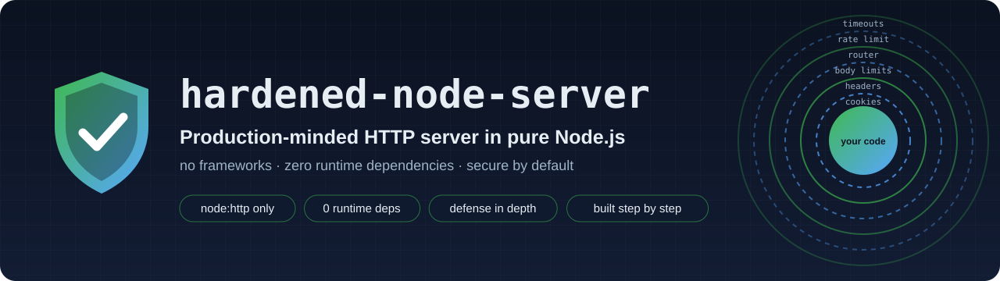
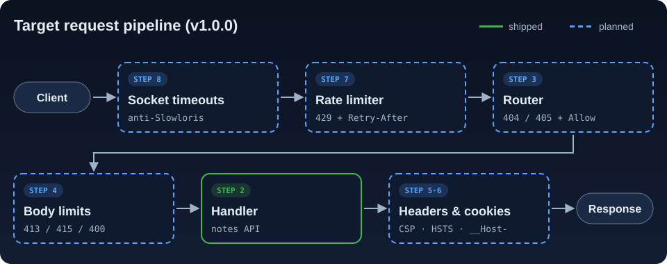

<div align="center">



<br>

[](LICENSE)
[](package.json)


**English** · [Português](README.pt-BR.md)

[In plain language](#-in-plain-language) ·
[Overview](#-overview) ·
[Architecture](#-target-architecture) ·
[Security model](#-security-model) ·
[Roadmap](#-roadmap) ·
[Getting started](#-getting-started)

</div>

> [!NOTE]
> **Built in public, step by step.** This README separates what is already **shipped** (✅, merged with evidence) from what is **planned** (⏳). Nothing is described as done before it is merged.

---

## 💡 In plain language

> For recruiters, managers and anyone without a technical background. The technical part starts at [Overview](#-overview).

### What is it?

Every website and app depends on a **server**: the program that receives requests ("show me my notes", "log me in") and sends back answers. This project builds that server **from scratch**, using only what comes with Node.js, with security as the starting point instead of an afterthought.

### An analogy

Think of a server as the **front desk of a building**. Most projects hire a ready-made security company (a *framework*) and trust that it does the right thing. This project trains the front desk team from zero, so every rule is known and written down:

| At the front desk | In the server |
|---|---|
| Sending each visitor to the right floor | **Router** |
| Refusing packages that are too big | **Body size limits** |
| Wristbands that cannot be copied | **Hardened cookies** |
| A maximum number of visits per minute | **Rate limiter** |
| Not letting someone block the door forever | **Timeouts** |
| Clear house rules posted at the entrance | **Security headers** |

### Why does it matter?

Many data leaks do not come from brilliant hackers but from **default settings nobody understood**. A developer who knows what happens *under* the framework can configure it safely, spot risky code in reviews and explain security decisions to the team.

### Before and after

| A typical tutorial server | This project | |
|---|---|:--:|
| Anyone can push code straight to production | Signed commits, protected main branch, changes only through reviewed pull requests | ✅ |
| Passwords and keys can slip into the code history | Automatic secret scanning before every commit | ✅ |
| Dozens of third-party packages to trust | Zero runtime dependencies | ✅ |
| Accepts uploads of any size | Size limits and clear error codes | ⏳ |
| No protection against login guessing or abuse | Rate limiting per client | ⏳ |
| Session cookies readable by malicious scripts | `HttpOnly`, `Secure`, `SameSite` cookies | ⏳ |
| Crashes or hangs under slow attacks | Timeouts and graceful shutdown | ⏳ |

### What it shows about the developer

| Skill | Evidence | |
|---|---|:--:|
| Secure development workflow | Signed commits, branch protection, PR-only changes ([#2](https://github.com/ADSLustosa/hardened-node-server/pull/2)) | ✅ |
| Secret leak prevention | gitleaks and private key detection in pre-commit | ✅ |
| Supply-chain awareness | No runtime packages, tools pinned to exact commits | ✅ |
| HTTP fundamentals | Router, status codes, request body handling (steps 2 to 4) | ⏳ |
| Application security | Security headers, cookies, rate limiting (steps 5 to 7) | ⏳ |
| Testing and DevOps | Automated tests, CI, hardened container (step 9) | ⏳ |

<details>
<summary><b>📖 Mini dictionary</b></summary>

<br>

| Term | Meaning |
|---|---|
| **Server** | Program that answers requests from browsers and apps |
| **Framework** | Ready-made toolkit that hides the details of how the server works |
| **Dependency** | Code written by third parties that a project relies on |
| **HTTP header** | Extra instructions sent with every answer, such as "do not show this page inside another site" |
| **Cookie** | Small piece of data the browser keeps to remember you are logged in |
| **Rate limiting** | Limiting how many requests one client can make in a period |
| **Slowloris** | Attack that opens connections and sends data very slowly to exhaust the server |
| **Signed commit** | Code change digitally signed, proving who wrote it |

</details>

---

## 🧭 Overview

`hardened-node-server` is a production-minded HTTP server built on Node's built-in [`node:http`](https://nodejs.org/api/http.html) module, with **no frameworks** and **zero runtime dependencies**. A small Notes API serves as the domain, so the focus stays on the HTTP and security layers: routing, body parsing, security headers, cookies, rate limiting and operational robustness.

### Design principles

- **Zero runtime dependencies.** Only `node:` built-ins in production: nothing to audit in `node_modules`, smaller attack surface.
- **Secure by default.** Protections are on unless explicitly turned off.
- **Fail closed.** When a request is ambiguous or too large, reject it with the right status code.
- **Explicit over magic.** Every behavior is visible in the code, no hidden middleware.
- **Prove, then document.** A feature is listed here only after it is merged with tests or evidence.

## 🧱 Target architecture

<div align="center">

</div>

Each request crosses the layers in order, and each layer can stop it early with the proper status code. Dashed boxes are planned; they turn solid as each step ships. The diagram is generated by [`assets/generate.py`](assets/generate.py).

## 🔐 Security model

| Threat | Control | Step | |
|---|---|:--:|:--:|
| Secrets leaked into git history | gitleaks + private key detection on every commit | 1 | ✅ |
| Tampered history or unreviewed changes | Signed commits, protected `main`, PR-only, no force push | 1 | ✅ |
| Supply-chain attacks | Zero runtime deps, hooks pinned by commit SHA, exact versions | 1 | ✅ |
| Memory exhaustion through huge bodies | Size limit → `413 Payload Too Large` | 4 | ⏳ |
| Content-type confusion and malformed input | `415` / `400` without leaking internals | 4 | ⏳ |
| Clickjacking, MIME sniffing, XSS impact | CSP, `X-Content-Type-Options`, `frame-ancestors`, HSTS, `Referrer-Policy` | 5 | ⏳ |
| Session theft (XSS / CSRF) | `HttpOnly`, `Secure`, `SameSite`, `__Host-` prefix | 6 | ⏳ |
| Brute force and abuse | Token bucket rate limiter → `429` + `Retry-After` | 7 | ⏳ |
| Slowloris and slow-body attacks | `headersTimeout`, `requestTimeout`, connection limits | 8 | ⏳ |
| Information leakage through errors | Centralized error handling, structured JSON logs | 8 | ⏳ |
| Container escape impact | Distroless image, non-root user | 9 | ⏳ |

## 🧰 Tech decisions

| Decision | Why |
|---|---|
| `node:http` instead of Express or Fastify | Learn and control what frameworks abstract away |
| TypeScript through Node's native type stripping | No build step; `tsc` only type-checks (`erasableSyntaxOnly`) |
| `node:test` as test runner | Built into Node, keeps dev dependencies minimal |
| Distroless, non-root container | Smaller image, no shell, limited blast radius |
| pre-commit + gitleaks | Problems are blocked before they reach the history |

## 📍 Roadmap

| # | Step | Status |
|:--:|---|:--:|
| 1 | Repository setup and hygiene | ✅ [#2](https://github.com/ADSLustosa/hardened-node-server/pull/2) |
| 2 | Minimal server (TypeScript via native type stripping) | ⏳ |
| 3 | Router: 404/405 with `Allow` | ⏳ |
| 4 | Request body: limits and validation (413/415/400) | ⏳ |
| 5 | Security headers | ⏳ |
| 6 | Hardened cookies (`HttpOnly`, `Secure`, `SameSite`, `__Host-`) | ⏳ |
| 7 | Rate limiter: token bucket, 429 + `Retry-After` | ⏳ |
| 8 | Robustness: errors, JSON logs, anti-Slowloris timeouts, graceful shutdown | ⏳ |
| 9 | Tests, CI and rootless distroless Docker image | ⏳ |
| 10 | Final documentation and v1.0.0 release | ⏳ |

Progress is tracked in the [`v1.0.0` milestone](https://github.com/ADSLustosa/hardened-node-server/milestones).

## ✅ Repository standards

Already enforced today:

- **Line endings and encoding** set by the repository (`.gitattributes`, `.editorconfig`), not by each machine
- **Node 26 required** (`.nvmrc`, `engines`, `engine-strict`)
- **Exact dependency versions** (`save-exact`)
- **pre-commit guards:** secret scanning (gitleaks), private key detection, JSON/YAML validation, all pinned by commit SHA
- **Protected `main`:** signed commits, pull requests only, no force pushes, no deletion

## 🚀 Getting started

> [!IMPORTANT]
> There is no server code yet (step 2 is next). Today you can clone the repository and prepare the environment.

Requirements: [Node.js 26](https://nodejs.org/) (via [nvm](https://github.com/nvm-sh/nvm)), [pre-commit](https://pre-commit.com/), Git with commit signing.

```bash
git clone git@github.com:ADSLustosa/hardened-node-server.git
cd hardened-node-server
nvm use            # reads .nvmrc and switches to Node 26
pre-commit install # enables the guards on every commit
```

## 🔁 Development workflow

1. One branch per task (`type/description`)
2. [Conventional Commits](https://www.conventionalcommits.org/), signed with SSH
3. Pull request with summary, changes and how it was tested
4. Merge commit into `main`, which closes the related issue

## 📄 License

[MIT](LICENSE) © 2026 João Pedro Lustosa
