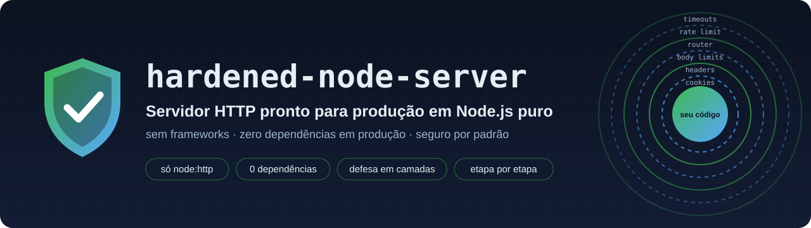
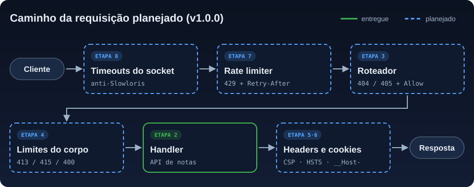

<div align="center">



<br>

[](LICENSE)
[](package.json)


[English](README.md) · **Português**

[Em linguagem simples](#-em-linguagem-simples) ·
[Visão geral](#-visão-geral) ·
[Arquitetura](#-arquitetura-planejada) ·
[Modelo de segurança](#-modelo-de-segurança) ·
[Roadmap](#-roadmap) ·
[Como começar](#-como-começar)

</div>

> [!NOTE]
> **Construído em público, etapa por etapa.** Este README separa o que já foi **entregue** (✅, com merge e evidência) do que está **planejado** (⏳). Nada é descrito como pronto antes do merge.

---

## 💡 Em linguagem simples

> Para recrutadores, gestores e qualquer pessoa sem formação técnica. A parte técnica começa em [Visão geral](#-visão-geral).

### O que é?

Todo site e todo aplicativo dependem de um **servidor**: o programa que recebe os pedidos ("mostre minhas notas", "faça meu login") e devolve as respostas. Este projeto constrói esse servidor **do zero**, usando só o que já vem com o Node.js, e com a segurança como ponto de partida, não como remendo no final.

### Uma analogia

Pense no servidor como a **portaria de um prédio**. A maioria dos projetos contrata uma empresa de segurança pronta (um *framework*) e confia que ela faz tudo certo. Este projeto treina a equipe da portaria desde o início, então cada regra é conhecida e documentada:

| Na portaria | No servidor |
|---|---|
| Encaminhar cada visitante ao andar certo | **Roteador** |
| Recusar encomendas grandes demais | **Limite de tamanho do corpo** |
| Pulseiras de acesso impossíveis de copiar | **Cookies protegidos** |
| Um número máximo de visitas por minuto | **Rate limiter** |
| Não deixar ninguém travar a porta para sempre | **Timeouts** |
| Regras da casa afixadas na entrada | **Cabeçalhos de segurança** |

### Por que isso importa?

Muitos vazamentos de dados não vêm de hackers geniais, e sim de **configurações padrão que ninguém entendeu**. Um desenvolvedor que sabe o que acontece *por baixo* do framework consegue configurá-lo com segurança, identificar código arriscado em revisões e explicar as decisões de segurança para o time.

### Antes e depois

| Um servidor típico de tutorial | Este projeto | |
|---|---|:--:|
| Qualquer pessoa envia código direto para produção | Commits assinados, branch principal protegida, mudanças só por pull request revisado | ✅ |
| Senhas e chaves podem vazar no histórico do código | Varredura automática de segredos antes de cada commit | ✅ |
| Dezenas de pacotes de terceiros em quem confiar | Zero dependências em produção | ✅ |
| Aceita envios de qualquer tamanho | Limites de tamanho e códigos de erro claros | ⏳ |
| Nenhuma proteção contra tentativas de senha ou abuso | Limite de requisições por cliente | ⏳ |
| Cookies de sessão legíveis por scripts maliciosos | Cookies `HttpOnly`, `Secure` e `SameSite` | ⏳ |
| Trava ou cai sob ataques lentos | Timeouts e desligamento controlado | ⏳ |

### O que o projeto mostra sobre o desenvolvedor

| Competência | Evidência | |
|---|---|:--:|
| Fluxo de desenvolvimento seguro | Commits assinados, proteção da branch, mudanças só por PR ([#2](https://github.com/ADSLustosa/hardened-node-server/pull/2)) | ✅ |
| Prevenção de vazamento de segredos | gitleaks e detecção de chave privada no pre-commit | ✅ |
| Atenção à cadeia de suprimentos | Nenhum pacote em produção, ferramentas fixadas em commits exatos | ✅ |
| Código com tipos seguros | `tsc` rigoroso com `erasableSyntaxOnly`, sobre TypeScript nativo ([#6](https://github.com/ADSLustosa/hardened-node-server/pull/6)) | ✅ |
| Testes automatizados | Suíte com `node:test`, prova vermelha e teste de regressão de segurança ([#6](https://github.com/ADSLustosa/hardened-node-server/pull/6)) | ✅ |
| Fundamentos de HTTP | Roteador, códigos de status, tratamento do corpo (etapas 3 e 4) | ⏳ |
| Segurança de aplicações | Cabeçalhos de segurança, cookies, rate limiting (etapas 5 a 7) | ⏳ |
| DevOps | Pipeline de CI e contêiner endurecido (etapa 9) | ⏳ |

<details>
<summary><b>📖 Minidicionário</b></summary>

<br>

| Termo | Significado |
|---|---|
| **Servidor** | Programa que responde aos pedidos de navegadores e aplicativos |
| **Framework** | Kit pronto que esconde os detalhes de como o servidor funciona |
| **Dependência** | Código escrito por terceiros do qual o projeto depende |
| **Cabeçalho HTTP** | Instruções extras enviadas com cada resposta, como "não exiba esta página dentro de outro site" |
| **Cookie** | Pequeno dado que o navegador guarda para lembrar que você está logado |
| **Rate limiting** | Limitar quantos pedidos um cliente pode fazer em um período |
| **Slowloris** | Ataque que abre conexões e envia dados bem devagar para esgotar o servidor |
| **Commit assinado** | Alteração de código com assinatura digital, que prova quem a escreveu |

</details>

---

## 🧭 Visão geral

O `hardened-node-server` é um servidor HTTP pensado para produção, construído sobre o módulo nativo [`node:http`](https://nodejs.org/api/http.html) do Node, **sem frameworks** e com **zero dependências em produção**. Uma pequena API de notas serve de domínio, para que o foco fique nas camadas de HTTP e segurança: roteamento, leitura do corpo, cabeçalhos de segurança, cookies, rate limiting e robustez operacional.

### Princípios de projeto

- **Zero dependências em produção.** Só módulos `node:` nativos: nada para auditar em `node_modules` e menor superfície de ataque.
- **Seguro por padrão.** As proteções ficam ligadas, a menos que sejam desligadas de forma explícita.
- **Na dúvida, recusar.** Quando uma requisição é ambígua ou grande demais, ela é rejeitada com o código de status correto.
- **Explícito em vez de mágico.** Todo comportamento está visível no código, sem middleware escondido.
- **Provar, depois documentar.** Um recurso só aparece aqui depois do merge, com testes ou evidência.

## 🧱 Arquitetura planejada

<div align="center">

</div>

Cada requisição atravessa as camadas em ordem, e cada camada pode interrompê-la cedo com o código de status adequado. As caixas tracejadas estão planejadas e ficam sólidas conforme cada etapa é entregue. O diagrama é gerado por [`assets/generate.py`](assets/generate.py).

## 🔐 Modelo de segurança

| Ameaça | Controle | Etapa | |
|---|---|:--:|:--:|
| Segredos vazados no histórico do git | gitleaks + detecção de chave privada em todo commit | 1 | ✅ |
| Histórico adulterado ou mudanças sem revisão | Commits assinados, `main` protegida, só PR, sem force push | 1 | ✅ |
| Ataques à cadeia de suprimentos | Zero dependências em produção, hooks fixados por SHA, versões exatas, scripts de instalação bloqueados, Dependabot com espera de 7 dias | 1 · 2 | ✅ |
| Exposição acidental na rede | Escuta em `127.0.0.1`, a menos que `HOST` seja definido de forma explícita | 2 | ✅ |
| Identificação da tecnologia do servidor | Sem o cabeçalho `X-Powered-By`, protegido por teste de regressão | 2 | ✅ |
| Esgotamento de memória com corpos enormes | Limite de tamanho → `413 Payload Too Large` | 4 | ⏳ |
| Confusão de content-type e entrada malformada | `415` / `400` sem expor detalhes internos | 4 | ⏳ |
| Clickjacking, MIME sniffing, impacto de XSS | CSP, `X-Content-Type-Options`, `frame-ancestors`, HSTS, `Referrer-Policy` | 5 | ⏳ |
| Roubo de sessão (XSS / CSRF) | `HttpOnly`, `Secure`, `SameSite`, prefixo `__Host-` | 6 | ⏳ |
| Força bruta e abuso | Rate limiter token bucket → `429` + `Retry-After` | 7 | ⏳ |
| Slowloris e ataques de corpo lento | `headersTimeout`, `requestTimeout`, limite de conexões | 8 | ⏳ |
| Vazamento de informação por erros | Tratamento centralizado de erros, logs estruturados em JSON | 8 | ⏳ |
| Impacto de fuga do contêiner | Imagem distroless, usuário sem privilégios de root | 9 | ⏳ |

## 🧰 Decisões técnicas

| Decisão | Por quê |
|---|---|
| `node:http` em vez de Express ou Fastify | Aprender e controlar o que os frameworks abstraem |
| TypeScript pelo type stripping nativo do Node | Sem etapa de build; o `tsc` só verifica tipos (`erasableSyntaxOnly`) |
| `node:test` como executor de testes | Já vem no Node e mantém as dependências de desenvolvimento mínimas |
| Contêiner distroless sem root | Imagem menor, sem shell, raio de impacto limitado |
| pre-commit + gitleaks | Problemas são barrados antes de entrar no histórico |

## 📍 Roadmap

| # | Etapa | Status |
|:--:|---|:--:|
| 1 | Configuração e higiene do repositório | ✅ [#2](https://github.com/ADSLustosa/hardened-node-server/pull/2) |
| 2 | Servidor mínimo (TypeScript com type stripping nativo) | ✅ [#6](https://github.com/ADSLustosa/hardened-node-server/pull/6) |
| 3 | Roteador: 404/405 com `Allow` | ⏳ |
| 4 | Corpo da requisição: limites e validação (413/415/400) | ⏳ |
| 5 | Cabeçalhos de segurança | ⏳ |
| 6 | Cookies protegidos (`HttpOnly`, `Secure`, `SameSite`, `__Host-`) | ⏳ |
| 7 | Rate limiter: token bucket, 429 + `Retry-After` | ⏳ |
| 8 | Robustez: erros, logs JSON, timeouts anti-Slowloris, desligamento controlado | ⏳ |
| 9 | Testes, CI e imagem Docker distroless sem root | ⏳ |
| 10 | Documentação final e release v1.0.0 | ⏳ |

O progresso é acompanhado na [milestone `v1.0.0`](https://github.com/ADSLustosa/hardened-node-server/milestones).

## ✅ Padrões do repositório

Já aplicados hoje:

- **Fim de linha e codificação** definidos pelo repositório (`.gitattributes`, `.editorconfig`), e não por cada máquina
- **Node 26 obrigatório** (`.nvmrc`, `engines`, `engine-strict`)
- **Versões exatas de dependências** (`save-exact`) e **scripts de instalação bloqueados** (`ignore-scripts`)
- **Verificação rigorosa de tipos** com `tsc` (`noEmit`, `erasableSyntaxOnly`, `verbatimModuleSyntax`)
- **Testes automatizados** com o executor nativo `node:test`
- **Dependabot** semanal, com espera de 7 dias e atualizações major em PRs separados
- **Barreiras no pre-commit:** varredura de segredos (gitleaks), detecção de chave privada, validação de JSON/YAML, todas fixadas por SHA de commit
- **`main` protegida:** commits assinados, só pull requests, sem force push e sem exclusão

## 🚀 Como começar

> [!IMPORTANT]
> Por enquanto, o servidor responde a toda requisição com um JSON de saúde (health). O roteamento chega na etapa 3.

Requisitos: [Node.js 26](https://nodejs.org/) (via [nvm](https://github.com/nvm-sh/nvm)), [pre-commit](https://pre-commit.com/), Git com assinatura de commits.

```bash
git clone git@github.com:ADSLustosa/hardened-node-server.git
cd hardened-node-server
nvm use            # lê o .nvmrc e troca para o Node 26
npm ci             # instala as versões exatas do package-lock.json
pre-commit install # ativa as barreiras em todo commit

npm test           # roda a suíte de testes
npm run typecheck  # verificação rigorosa de tipos com o tsc
npm start          # http://127.0.0.1:3000 (HOST e PORT podem ser alterados)
```

```console
$ curl -i http://127.0.0.1:3000/
HTTP/1.1 200 OK
Content-Type: application/json; charset=utf-8
Content-Length: 15

{"status":"ok"}
```

O TypeScript roda direto no Node 26 (sem etapa de build): o `tsc` só verifica os tipos.

### Estrutura do projeto

```text
src/app.ts      monta o servidor (pode ser importado pelos testes)
src/server.ts   ponto de entrada: lê HOST/PORT e escuta a porta
test/           suítes do node:test
assets/         visuais do README e o gerador deles
```

## 🔁 Fluxo de desenvolvimento

1. Uma branch por tarefa (`tipo/descricao`)
2. [Conventional Commits](https://www.conventionalcommits.org/pt-br/), assinados com SSH
3. Pull request com resumo, mudanças e como foi testado
4. Merge commit na `main`, que fecha a issue relacionada

## 📄 Licença

[MIT](LICENSE) © 2026 João Pedro Lustosa
